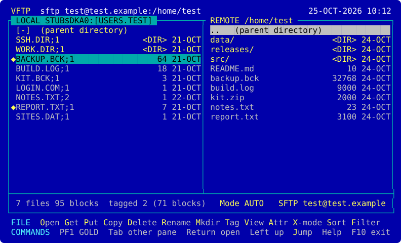

  

# vms-vftp

A full-screen FTP, SFTP and SCP client for OpenVMS, for x86-64 and IA64, in the style
of [VTREE](https://github.com/issinoho/vms-vtree) and [VLMF](https://github.com/issinoho/vms-vlmf):
local and remote files in two framed panes, XTree Gold's colours, one-letter commands
and PF1 as the GOLD key. Part of the [ports and tools for OpenVMS](https://openvms.issinoho.com)
family.

- **SFTP** to any SSH server, by [libssh2](https://github.com/issinoho/vms-libssh2)
  (linked in): key or password login, the server's key checked against `known_hosts`.
- **SCP** to Unix servers: files by scp, listing, rename, delete and permissions by
  shell commands, as WinSCP's SCP mode does.
- **FTP** and **FTPS** (explicit, `AUTH TLS`), passive, the certificate pinned on first
  use; to VMS and Unix servers.
- Get and Put of files and whole directories, text or binary (AUTO by record format
  and type), a saved-sites list, a server's permissions (`644`, `go-w`), and resume of
  an interrupted binary transfer (SFTP, and FTP where the server has `REST`).

**Status: 0.1.1, an early test release.** Tested end to end on x86-64 (E9.2-4) and
IA64 (V8.4-2L3) against VMS sshd and the TCP/IP Services FTP server, and against
OpenSSH and an FTP/FTPS server on Linux. See [docs/PLAN.md](docs/PLAN.md).

## Installing

VFTP needs VSI's SSL3 kit (V3.0 or later). libssh2 is linked into the image, so its kit
is not needed to run VFTP. A kit downloaded through a non-VMS system loses its record
format. Restore it, then install:

    $ SET FILE/ATTRIBUTE=(RFM:FIX,LRL:8192,MRS:8192,RAT:NONE) ISSINOHO-*-VFTP-T0001-1-1.PCSI
    $ PRODUCT INSTALL VFTP /PRODUCER=ISSINOHO /SOURCE=dev:[dir]

Add `@SYS$STARTUP:VFTP$STARTUP.COM` to `SYS$MANAGER:SYSTARTUP_VMS.COM` to define the
`VFTP` logical names at every boot, and `@VFTP$ROOT:[000000]VFTP$SETUP.COM` to
`SYS$MANAGER:SYLOGIN.COM` (or a `LOGIN.COM`) to define the `VFTP` command.

    $ VFTP                          ! the Open form
    $ VFTP user@host:port           ! the Open form filled in
    $ VFTP mysite                   ! a saved site

It needs a VT100-compatible terminal of at least 20 x 80. On a terminal without colour,
`DEFINE VFTP$DISPLAY MONO` first. Help (or PF2) shows the keys; F10 or Ctrl/Z leaves.

## Building from source

With VSI C and SSL3, and libssh2 from [vms-libssh2](https://github.com/issinoho/vms-libssh2)
(its kit installed, or its build tree):

    $ @build_vms                    ! uses LIBSSH2$ROOT, the installed kit
    $ @build_vms "" dev:[dir.INSTALL_X86_64]   ! or a vms-libssh2 build tree
    $ @build_vms TEST               ! also the unit and screen tests
    $ VFTP :== $dev:[dir.BUILD]VFTP.EXE

On Linux, `make test` builds and runs the same tests against a stub platform.

## Safety first

- A download is always a new version: no local file is ever replaced.
- Replacing a file on a server, and every delete, shows what would change and asks;
  the answer is No unless you type Y. On a server without versions a Put goes to a
  temporary name and replaces the file only once it has arrived whole.
- An unknown server's key shows its fingerprint and asks; a changed one is refused.
- Plain FTP sends the password in the clear, so VFTP asks before it does.
- Passwords are never stored, not in the sites file and not in the log.
- Every operation is logged (`VFTP$LOG`, default `SYS$LOGIN:VFTP.LOG`).

The reasoning is in [docs/DECISIONS.md](docs/DECISIONS.md), what was observed on the
nodes in [docs/NOTES.md](docs/NOTES.md).

## Licence

MIT. See [LICENSE](LICENSE). libssh2, linked into VFTP.EXE, is under its BSD-3-Clause
licence ([kit/libssh2-copying](kit/libssh2-copying), installed as `LIBSSH2-COPYING.`).
